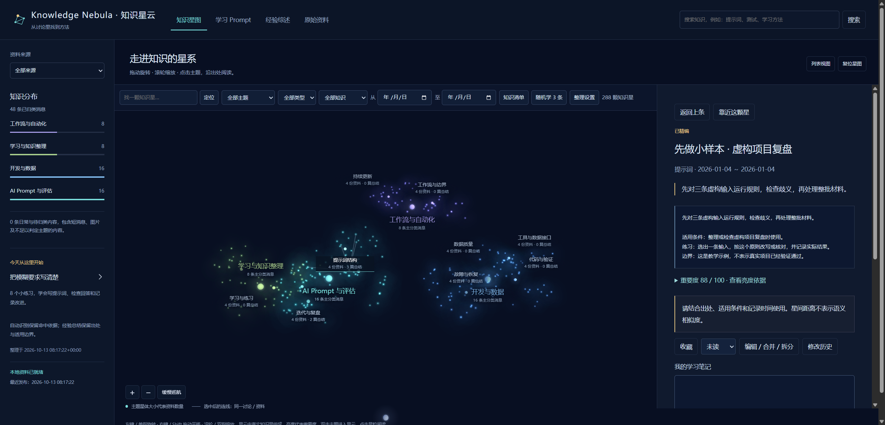

# Knowledge Nebula · 知识星云

一个在本机运行的三维知识库。将笔记、文档或聊天导出整理成小知识，像探索星云一样旋转、缩放、点击阅读，并沿出处查看原文。

**[下载 v0.1.0 ZIP](https://github.com/Dre-am-requset/knowledge-nebula/releases/download/v0.1.0/knowledge-nebula-v0.1.0.zip)** · [查看 Release 与使用说明](https://github.com/Dre-am-requset/knowledge-nebula/releases/tag/v0.1.0)



## 功能

- **三维星云**：拖动旋转、缩放、悬停预览、点击阅读、双击靠近，支持缓慢巡航。
- **知识组织**：大类、主题、小知识三级导航；亮度表示阅读重要度。
- **搜索与筛选**：按关键词、来源、日期、知识类型和学习状态查找。
- **学习记录**：收藏、待学、已读、笔记和 Prompt 练习进度保存在本机。
- **人工整理**：编辑、合并、拆分与修订历史；来源变化时提示待复核。
- **数据导入**：支持统一 JSON 与离线飞书消息 JSON 转换；导入后页面更新并保留视角。

## 快速使用

需要 **Python 3.10+** 和支持 WebGL 的现代浏览器。无需安装 Python 第三方依赖。

```sh
python -m nebula serve --demo
```

浏览器打开 **http://127.0.0.1:8768/**。保持终端运行，按 Ctrl+C 停止。

Windows 可双击 `start.cmd`；macOS/Linux 可运行 `sh start.sh`。
首次启动附带 288 条自编演示知识、48 份示例资料和 Prompt 学习练习。

## 导入自己的内容

参考 [`examples/minimal.json`](examples/minimal.json) 准备数据：

```sh
python -m nebula import data/my-knowledge.json
```

详细格式、飞书 JSON 转换和打包方法见 [使用说明](docs/USAGE.md)。

## 数据与许可

技术栈：**Python 标准库 + SQLite + Vanilla JavaScript + Three.js**。资料与笔记存储在自己的电脑，默认只监听本机地址。

仓库只包含源码和自编演示资料，不包含真实聊天、私人文档、账户凭据或个人数据库。
`data/` 中的运行数据不纳入 Git；分享源码时使用附带的打包工具。

星之间的距离由稳定 ID 与主题决定，不表示语义相似度；当前版本没有自动模型调用或向量检索。

项目采用 [MIT 许可](LICENSE)。Three.js 的原始许可见 [第三方说明](THIRD_PARTY_NOTICES.md)。
